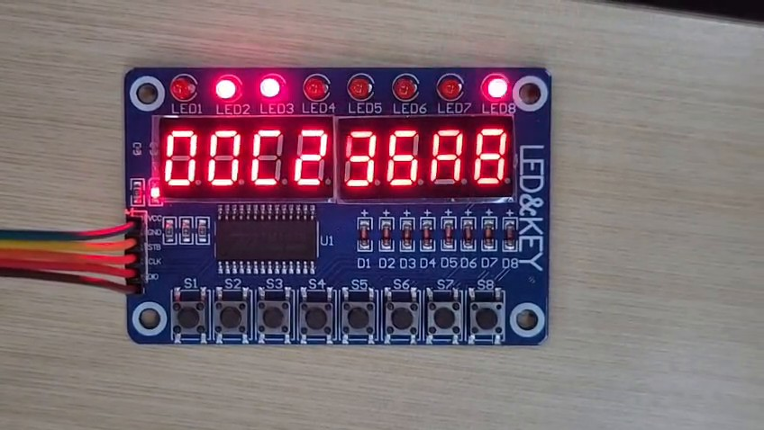

# Project UAS: SoC PicoRV32

Mirzariel Akmal Norman (23/523162/TK/57284)
TKEE262703 Digital IC Design, Dosen: Ir. Agus Bejo, S.T., M.Eng., D.Eng., IPM.

SoC dengan prosesor PicoRV32, AXI4-Lite interconnect 1 master 4 slave, ROM, RAM, GPIO,
dan pengendali modul LED&KEY TM1638, dijalankan di board **iCESugar v1.5 (iCE40UP5K)**
dengan alat open source (Yosys, nextpnr-ice40, icepack, iverilog).
Dasar proyek: template dari dosen (`uas-soc-design.zip`).

**Video demo:** [dokumentasi/demo_soc_tm1638.mp4](dokumentasi/demo_soc_tm1638.mp4)

**Makalah:** [dokumentasi/Makalah_Project_UAS_SoC.pdf](dokumentasi/Makalah_Project_UAS_SoC.pdf)



Foto diambil sekitar 7 detik setelah board dicolok: 7-segment menampilkan counter dari
program dosen dalam heksa, LED1..LED8 menampilkan bit 24..17 counter.

## Isi SoC

```
PicoRV32 --bus_picorv32--> AXI4-Lite Interconnect
                             |-- m0 : bus_rom    --> ROM 4 KB   0x0000_0000
                             |-- m1 : bus_ram    --> RAM 4 KB   0x0001_0000
                             |-- m2 : bus_gpio   --> GPIO       0x0002_0000
                             |-- m3 : bus_tm1638 --> TM1638     0x0003_0000
```

Program yang dijalankan adalah `firmware.hex` dari template (6 instruksi): counter yang
ditambah 3 lalu ditulis terus ke alamat `0x0003_0000`. Modul TM1638 menampilkan angka itu
dalam heksa di 8 digit 7-segment. LED1..LED8 menampilkan bit 24..17.

## Nama di soal dan file di proyek ini

| Di soal | File |
|---|---|
| `picorv32.v` | `rtl/soc_picorv32/picorv32/picorv32.v` |
| `axi4_lite_interconnect_m1s4.v` | `rtl/soc_picorv32/interconnect/axi4_lite_interconnect_m1s4.v` |
| `axi_rom.v` | `rtl/soc_picorv32/peripherals/axi4_lite_rom.v` |
| `axi_ram.v` | `rtl/soc_picorv32/peripherals/axi4_lite_ram.v` |
| `axi_gpio.v` | `rtl/soc_picorv32/peripherals/axi4_lite_gpio.v` |
| `axi_tm1638.v` | `rtl/soc_picorv32/peripherals/axi4_lite_tm1638.v` (+ `tm1638.v` dari dosen) |
| `top_soc_picorv32.v` | `rtl/soc_picorv32/top_soc_picorv32.sv` (SystemVerilog interface) |
| `top_soc_picorv32.tcl` | `tcl/soc_picorv32/top_soc_picorv32.tcl` |

Nama file mengikuti template baru. Setiap modul punya wrapper `.sv` di `rtl/soc_picorv32/wrapper/`.

## Sambungan modul LED&KEY

| Modul TM1638 | iCESugar (header PMOD1) |
|---|---|
| VCC | 3V3 |
| GND | GND |
| STB | P48 |
| CLK | P3 |
| DIO | P2 |

Pin ini sudah dicoba dan menyala di board. Pin yang diberikan soal (STB=P9, CLK=P4, DIO=P2)
bisa dipilih dengan `PIN=soal`. Di board kami, dengan pin soal display sempat jalan sekitar
3 detik lalu macet saat iCELink aktif, walaupun jumper J5 (UART iCELink ke pin 4) sudah
dilepas. Penyebabnya belum kami ketahui.

## Menyiapkan environment

1. Pasang [OSS CAD Suite](https://github.com/YosysHQ/oss-cad-suite-build) dan GNU Make.
2. Sesuaikan path di `setenv-oss.bat` dengan lokasi OSS CAD Suite.
3. Buka **cmd** (bukan Git Bash), masuk ke folder ini, lalu jalankan `setenv-oss.bat`.

Makefile memakai perintah cmd (`if not exist`, `rmdir /S /Q`), jadi dijalankan di Windows.

## Cara menjalankan

```
make sim       simulasi dengan iverilog, hasilnya PASS / FAIL
make syn       sintesis dengan Yosys (tcl/soc_picorv32/top_soc_picorv32.tcl)
make pnr       place & route dengan nextpnr-ice40
make bit       bitstream dengan icepack -> build/build_soc_picorv32/bitstream/top_soc_picorv32.bin
make prog      upload ke iCESugar dengan icesprog
make all       syn + pnr + bit
make all SLANG=1   sama, tetapi Yosys membaca RTL dengan read_slang (lihat di bawah)
make simgate   (tambahan) simulasi netlist hasil Yosys, jalankan setelah make syn
make hex       (tambahan) ubah firmware.hex 1 byte/baris menjadi 1 word/baris
make clean / make cleanall
```

Contoh lengkap:

```
setenv-oss.bat
make sim
make all
make prog
```

Bitstream yang sudah jadi juga ada di folder `bitstream/`, jadi bisa langsung diunggah dengan
`icesprog bitstream/top_soc_picorv32.bin` atau dengan menyeret file `.bin` ke drive iCELink.

## Dua cara sintesis (read_verilog dan read_slang)

Template V2 dari dosen mengganti `read_verilog` dengan `read_slang` (plugin slang), karena
pembaca bawaan Yosys tidak menerima semua cara menulis SystemVerilog interface. Proyek ini
bisa disintesis dengan dua cara, dan file RTL-nya sama:

| | Cara A (bawaan) | Cara B |
|---|---|---|
| Perintah | `make all` | `make all SLANG=1` |
| Perintah baca di TCL | `read_verilog` / `read_verilog -sv` | `plugin -i slang` + `read_slang` |
| Folder hasil | `build/build_soc_picorv32` | `build/build_soc_picorv32_slang` |
| Bitstream | `top_soc_picorv32.bin` | `top_soc_picorv32_slang.bin` |
| LUT / flip-flop / BRAM | 2317 / 922 / 20 | 2312 / 922 / 20 |
| Sel logika (nextpnr) | 2651 / 5280 | 2655 / 5280 |
| Fmax | 25,78 MHz | 22,88 MHz |
| `make simgate` | PASS | PASS |

Cara A butuh dua penyesuaian: sambungan interface ditulis `.s0(bus)` (bukan `.s0(bus.slave)`)
dan `clk, rst_n` ditambahkan ke modport. Cara B menerima tulisan asli dosen, tetapi tulisan
`.s0(bus)` tetap dipakai karena iverilog (`make sim`) menolak `.s0(bus.slave)`.
Penjelasan lengkap ada di makalah Subbab 4.8 dan 6.8.

## Hasil

| | |
|---|---|
| `make sim` | PASS (layar = angka dari CPU; tahap 2: layar `12345678`, LED `00011010`) |
| `make simgate` | PASS, angka sama dengan simulasi RTL |
| Sel logika | 2.651 / 5.280 (50%) |
| BRAM | 20 / 30 |
| Fmax | 25,78 MHz (target 12 MHz) |
| Bitstream | 104.090 byte |
| Board | counter berjalan di 7-segment dan LED (bitstream cara A) |

Counter naik sekitar 1,9 juta per detik (1 putaran program = 19 clock pada 12 MHz), jadi
digit kiri berganti pelan (digit ke-2 kira-kira tiap 9 detik), sedangkan digit kanan
berubah terlalu cepat dan terlihat seperti angka 8.

## Perubahan dari template

Semua perubahan diberi komentar `diubah: ... karena ...` di file terkait.

- `top_soc_picorv32.sv`: koma diperbaiki, `bus_tm1638` dan port TM1638 ditambah, reset
  otomatis (board tidak punya tombol reset FPGA), sambungan interface ditulis `.m0(bus)`
  karena iverilog menolak `.m0(bus.master)`.
- `if_axi4_lite.sv`: `clk` dan `rst_n` ditambah ke modport supaya Yosys mau mensintesis.
- `axi4_lite_rom.v` dan `axi4_lite_ram.v`: diperkecil menjadi 4 KB (ukuran asli butuh 66 BRAM,
  chip hanya punya 30); loop pengisi nol di ROM dihapus karena di Yosys loop itu menimpa
  `$readmemh` sehingga ROM di bitstream kosong.
- `axi4_lite_ram_wrapper.sv`: diisi (sebelumnya kosong).
- `axi4_lite_gpio.v`: saat reset semua pin input (sesuai komentar di file itu).
- `axi4_lite_tm1638.v` dan `axi4_lite_tm1638_wrapper.sv`: modul baru.
- `Makefile`, `top_soc_picorv32.tcl`, `.pcf`, `setenv-oss.bat`: diperbaiki supaya bisa dijalankan.
- `Makefile` dan `top_soc_picorv32.tcl`: ditambah pilihan `SLANG=1` untuk sintesis dengan `read_slang`.
